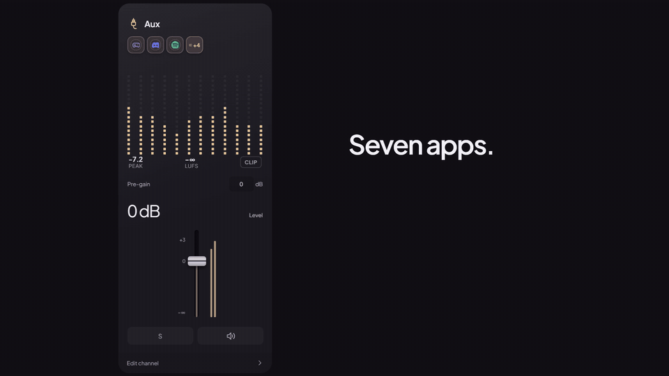
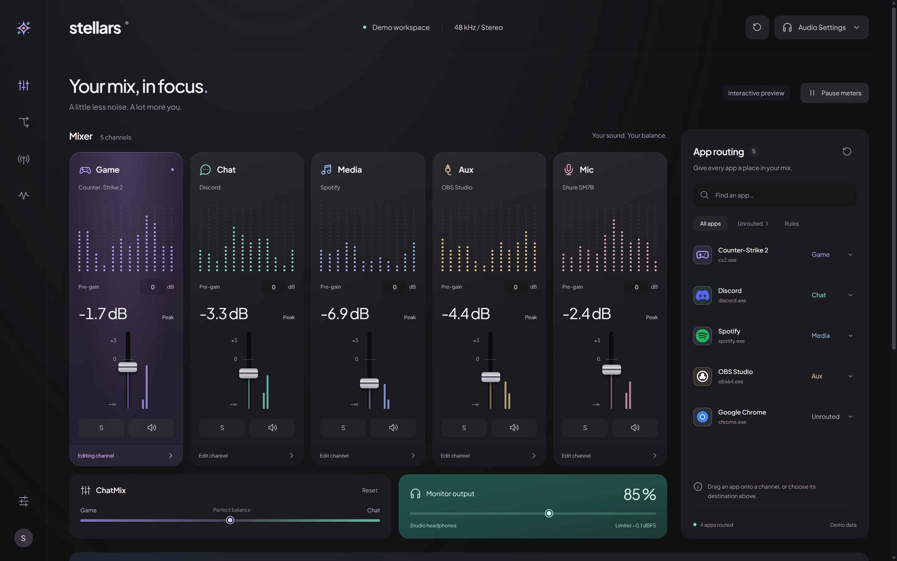
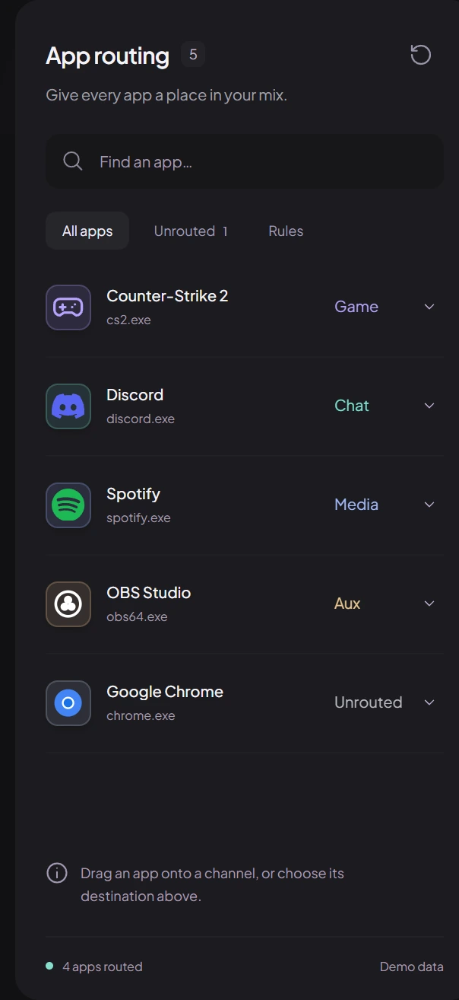
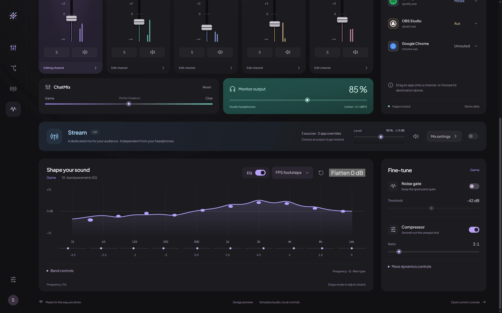
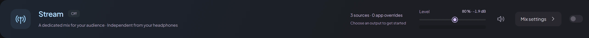

<picture>
  <source media="(prefers-color-scheme: dark)" srcset="docs/media/stellars-lockup-horizontal-dark.svg">
  
</picture>

### Give every app its own mix. Shape each one in real time.

A multi-bus audio router and mixer for Windows.

Drag Discord into Chat, balance it with ChatMix, switch the EQ to footsteps, add the noise gate and the Stream mix.

[**Product Showcase**](https://stellars.cafetako.com/) · [**Download**](https://github.com/giran03/Stellars/releases/latest) · [Features](#-features) · [Quick start](#-quick-start) · [Requirements](#-requirements)

 

> [!NOTE]
> Stellars runs entirely in user mode and installs **no kernel driver of its own**.

> [!TIP]
> New here? Jump to the [Quick start](#-quick-start). You can be routing apps in under a minute.

## ✨ Features

<table>
<tr>
<td width="50%" valign="top">

### 🎚️ Five channels
Game, Chat, Media and Aux for your apps, plus a Mic channel for your microphone. Drag any running app onto a channel, or pick one from its menu.

</td>
<td width="50%" valign="top">

### 🎛️ 10-band parametric EQ
On every channel, with presets, A/B comparison and custom presets.

</td>
</tr>
<tr>
<td width="50%" valign="top">

### 🎬 Stream mix
Send a separate mix to its own virtual cable. Your stream hears what you choose, without changing what you hear.

</td>
<td width="50%" valign="top">

### 🤖 AI noise suppression
For Mic and Chat, with a fast engine (RNNoise) and a high-quality engine (DeepFilterNet3).

</td>
</tr>
</table>

| | | |
|---|---|---|
| 🎞️ **Scenes**   Save a full mix and bring it back in one click, or apply it automatically when an app gains focus. | 🎮 **ChatMix**   One crossfader to balance Game against Chat. | 🔉 **Auto-ducking**   Lower chosen channels while another is active. |
| 📊 **Live metering**   Peak, RMS and LUFS with clip indicators, plus a master limiter. | 🪄 **Quick recipes**   Streaming voice, Noisy room, Hear footsteps and more. | 🌗 **Light and dark**   Tactile theme switch, or press `Alt+T`. |

## 👀 Everything, one glance away

Explore the interactive feature tour with annotated callouts on the [**Stellars Showcase**](https://stellars.cafetako.com/).

### 🎚️ The mixer
Five channels, each with its own fader, pre-gain, solo, mute and live meters. ChatMix and the monitor output sit right underneath.

### 🔀 Routing

- **Drag, drop or click:** drag an app onto a channel, or pick a channel from the app's menu. Drag it back to the pool to restore Windows' default.
- **Per-app control:** each app has its own volume, and routing rules are remembered between sessions.
- **Scenes and output profiles:** save a full mix and restore it in one click. Scenes can apply automatically when a chosen app comes into focus.
- **ChatMix:** a single crossfader to balance Game against Chat.

### 🎧 Sound shaping

| Tool | What it does |
|---|---|
| **10-band parametric EQ** | On every channel, with presets, A/B comparison and custom presets |
| **Noise gate, compressor, de-esser, limiter** | Per channel, with live gain-reduction readouts and transfer curves |
| **AI noise suppression** | RNNoise (fast) or DeepFilterNet3 (high quality), for Mic and Chat |
| **Auto-ducking** | Lowers chosen channels automatically while another is active |
| **Quick setup recipes** | One-click starting points: Streaming voice, Noisy room, Hear footsteps |
| **Live metering** | Peak, RMS and LUFS meters with clip indicators, plus a master limiter |

### 📡 Stream mix

- **A separate recording mix** sent to its own virtual audio cable, so your stream hears what you choose without affecting what you hear.
- **Choose what goes in:** include whole channels or individual apps, with per-app overrides, its own level, mute and limiter.
- **Solo headphones:** listen to the stream mix on your monitor output without changing your saved mix.

## 🧰 Made for everyday use

- **Simple and Advanced modes:** start with the essentials and reveal every control when you want it.
- **Lives in the system tray:** closing the window releases the interface and leaves only the audio engine running. The tray menu opens beside the icon with quick actions, including mute-all.
- **Resource saver:** meters slow down in the background and stop while hidden. Audio is never affected.
- **Reconnects devices automatically** when a headset, microphone or cable comes back.
- **Automatic backups** of your settings and presets, with one-click restore.
- **Built-in diagnostics and logs** for audio load, underruns and device state.

## 📋 Requirements

- Windows 11, or Windows 10 build 20348 or later (64-bit)
- Microsoft Edge WebView2 (installed automatically if missing)
- A virtual audio cable for the Stream and Mic routes. The installer sets up VB-CABLE for you, and Stellars can repair or re-route it later from **Hardware I/O**.

> [!IMPORTANT]
> **Keep one spare audio output free for the silent sink.** Stellars routes apps through a silent sink so you never hear them unprocessed. When both virtual cables are already taken (silent sink and virtual mic), there is no cable left for the Stream mix. In that case pick a spare physical output you don't listen to, such as a monitor's HDMI audio, in the **Stream** cable card. Stellars mutes it, uses it as the silent sink and hands the freed cable to the Stream mix. It unmutes the output again when it stops being the silent sink.
>
> The output can't be your monitor output or the Windows default device.

## 📥 Download and install

1. Download the latest installer from the [Releases page](https://github.com/giran03/Stellars/releases/latest).
2. Run it and follow the prompts.
3. Open Stellars. The first-run wizard helps you choose an interface mode and set up your devices.

## 🚀 Quick start

1. **Play something.** Start a game, a call or some music so the app shows up in the app list.
2. **Route it.** Drag the app onto a channel, or open its menu and choose one.
3. **Balance it.** Move the channel fader, press **S** to solo or the speaker to mute, and open **Edit channel** to shape the EQ and processing.
4. **Add a stream mix** (optional). Open **Stream**, choose what to include, pick your virtual cable as the output and switch it on. Then select that cable as the audio source in your streaming software.
5. **Close to the tray.** Stellars keeps routing in the background. Left-click the tray icon to reopen the window, right-click for quick actions.

 

---

**Stellars** · Designed and built by **CafeTako Team**

[Showcase](https://stellars.cafetako.com/) · [Download](https://github.com/giran03/Stellars/releases/latest) · [Changelog](CHANGELOG.md)

